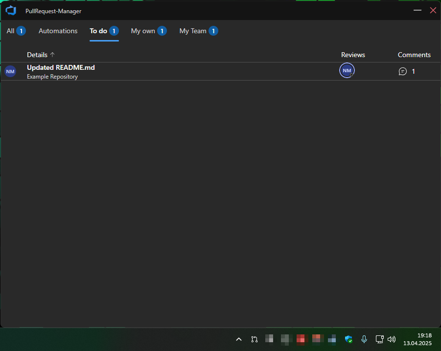
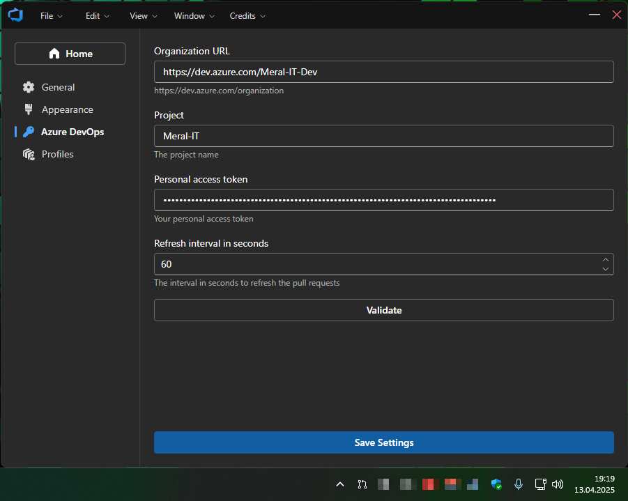

# PullRequestManager

[](https://github.com/Meral-IT/PullRequest-Manager/actions/workflows/auto-release.yml)
[](https://sonarcloud.io/summary/new_code?id=Meral-IT_PullRequest-Manager)

## Table of Contents

- [Overview](#overview)
- [Features](#features)
- [Profile Filters](#profile-filters)
- [Screenshots](#screenshots)
- [Technologies Used](#technologies-used)
- [Help Wanted](#help-wanted)
- [Contributing](#contributing)
- [DevOps Integration](#devops-integration-work-in-progress)
- [Installation](#installation)
- [Building the Application](#building-the-application)
- [Project Structure](#project-structure)
- [Special Thanks](#special-thanks)
- [License](#license)

## Overview

PullRequestManager is a powerful desktop application designed to simplify the management of pull requests in Azure DevOps. With an intuitive user interface and seamless integration, it helps developers efficiently review, filter, and manage pull requests directly from their desktop.

## Features

- 🛠️ **Comprehensive Pull Request Management** – View, filter, and organize pull requests with ease.
- 🔍 **Advanced Search & Filtering** – Quickly find relevant pull requests using robust search options.
- 🎨 **User-Friendly Interface** – Built with Fluent UI for a clean and modern experience.
- 🔄 **Multi-Project Support** – Seamlessly switch between different Azure DevOps projects.
- 🌐 **Git Integration** – Easily manage branches and streamline the development workflow.
- 🔔 **Desktop Notifications** – Get notified when new pull requests arrive, with optional sound alerts.

Use the filter icon beside the profile tabs to toggle the filter line. Text search matches repository,
author, PR title, or full description, ignoring case. Combine it with **Created by** and **Target branch**
to narrow each profile. Filter values and the line's visibility stay shared when switching tabs.
**Ctrl+F** (**Cmd+F** on macOS) reveals the line and focuses search;
Each control's **×** resets its value. The **×** at the end clears all filters and hides the line;
**Escape** resets all filters without hiding it. Toggling the filter icon keeps filters active,
as indicated by the highlighted icon. The profile's **Approve all** action includes only matching PRs.

## Profile Filters

Open a profile in Settings to edit its filter with JSON completion, hover help, formatting, and inline errors. Filters are checked against the supported fields and values, including nested author and reviewer conditions. Unknown properties and invalid filters block saving until repaired.

Leave the filter blank to include all pull requests. Previously saved invalid filters match no pull requests until corrected; opening Settings keeps them available for repair.

Edit a profile's JSON filter in Settings. To find PRs you have not approved, including rejected, waiting-for-author, and unvoted reviews, use:

```json
{
  "op": "AND",
  "filters": [
    {
      "reviewers": {
        "op": "AND",
        "filters": [
          {
            "user": { "isMySelf": true },
            "isApproved": false
          }
        ]
      }
    }
  ]
}
```

`isApproved: true` matches both Approved and Approved with suggestions; `false` matches No vote, Waiting for author, and Rejected. Existing numeric `vote` filters still match one exact vote, and can be combined with `isApproved`.

Each reviewer filter must match at least one reviewer. The example checks your review, so another reviewer's approval does not hide a PR you still need to review; PRs without a matching reviewer are excluded. Without the `user` condition, it matches any reviewer who has not approved. `reviewers.op` combines these existence checks with `AND` or `OR`; it does not require all reviewers to have the same approval state.

## Screenshots

Below are screenshots showcasing the PullRequestManager interface:

|             **Pull Requests List**             |                **Azure DevOps settings**                |
| :--------------------------------------------: | :-----------------------------------------------------: |
|  |  |

## Technologies Used

PullRequestManager is built with the following modern technologies:

- [**Electron**](https://www.electronjs.org/) – Enables cross-platform desktop applications.
- [**React**](https://react.dev/) – A powerful frontend library for building dynamic interfaces.
- [**Fluent UI**](https://developer.microsoft.com/en-us/fluentui) – Microsoft's UI framework for a polished, professional look.
- [**TypeScript**](https://www.typescriptlang.org/) – Ensures type safety and improves code maintainability.

## Help Wanted

We are actively looking for contributors to improve PullRequestManager! If you're interested in helping out, feel free to check out the issues tab or submit a pull request. Any contributions, whether code, documentation, or feedback, are highly appreciated!

## Contributing

We welcome contributions from the community! See the [contribution guide](./CONTRIBUTING.md) if you want to participate in this project.

### Guidelines

- Ensure your code passes all tests and adheres to the project's linting rules.
- Include documentation updates if your changes affect the user interface or functionality.
- Be responsive to feedback during the review process.

Thank you for contributing to PullRequestManager!

## DevOps Integration (Work in Progress)

We are currently working on deeper integration with Azure DevOps, making it even easier to manage pull requests within the platform. The upcoming features include:

- Real-time sync with Azure DevOps repositories
- Enhanced automation for pull request workflows
- Improved UI/UX for better collaboration

Stay tuned for updates!

## Installation

### Prerequisites

Before you begin, ensure you have the following installed:

- [Node.js](https://nodejs.org/) 24.16 or newer with npm 11 or newer (`nvm use` selects Node 24)
- [Git](https://git-scm.com/)

### Setup Instructions

1. Clone the repository:

   ```sh
   git clone https://github.com/Meral-IT/PullRequest-Manager
   cd PullRequest-Manager
   ```

2. Install dependencies:

   ```sh
   npm ci
   ```

3. Start the application:

   ```sh
   npm run dev
   ```

The install step explicitly downloads the Electron binary before preparing native dependencies because electron-vite
does not trigger Electron's on-demand download. If dependencies were installed with scripts disabled, run
`npm run postinstall` before `npm start` or `npm run dev`.

## Building the Application

To generate a production-ready build, run the following command:

```sh
npm run build
```

This checks both TypeScript projects and bundles the main process, sandboxed preload, and React renderer. Run
`npm run lint` for lint checks, or `npm run lint:fix` to apply fixes. To create an installer, use `npm run build:win`,
`npm run build:mac`, or `npm run build:linux`. `npm run build:unpack` creates an unpacked application for local testing.
After building, `npm test` launches a hidden Electron window with temporary settings to check the bundled React
renderer, sandboxed preload, and IPC bridge. On Linux CI, run it with `xvfb-run -a npm test`.

The build uses Electron 45, electron-vite 6, and Vite 8. Node.js types follow Electron's embedded Node 24 runtime.
TypeScript 7 provides `tsc`; the `typescript` dependency aliases Microsoft's TypeScript 6 compatibility package so
ESLint can still use the compiler API, as described in the
[TypeScript 7 migration guidance](https://devblogs.microsoft.com/typescript/announcing-typescript-7-0/#running-side-by-side-with-typescript-60).
The ESM build config uses Vite's `rolldownOptions` and electron-vite's built-in dependency handling. Preload
dependencies are bundled to support Electron's renderer sandbox. React DevTools are installed only in development.
Packaged builds also disable Node environment/inspection switches and require the integrity-checked ASAR archive.

Electron 45 requires macOS 13 or later and a 64-bit platform. macOS desktop notifications require a code-signed
application. For a local macOS package without a Developer ID certificate, use
`npm run build:unpack -- --config.mac.identity=- --config.mac.hardenedRuntime=false` to apply an ad-hoc signature
after the fuse changes. Distribution builds still need your Developer ID signing and notarization credentials;
notarization is currently disabled in
`electron-builder.yml`.

## Project Structure

<!-- prettier-ignore-start -->

```markdown
├── app/ # Renderer process files
│ ├── assets/ # Static assets (images, fonts, etc)
│ ├── components/ # React components
│ │ ├── App.tsx # Application component
│ ├── styles/ # CSS and Tailwind files
│ │ ├── app.css # App stylesheet
│ │ └── tailwind.css # Tailwind stylesheet
│ ├── index.html # Entry HTML file
│ └── renderer.tsx # Renderer process entry
├── lib/ # Shared library code
│ ├── main/ # Main process code
│ │ ├── index.ts # Main entry point for Electron
│ │ └── ... # Other main process modules
│ ├── preload/ # Preload scripts for IPC
│ │ ├── index.ts # Preload script entry
│ │ └── api.ts # Exposed API for renderer
│ ├── welcome/ # Welcome kit components
│ └── window/ # Custom window implementation
├── resources/ # Build resources
├── eslint.config.mjs # ESLint flat configuration
├── .prettierrc # Prettier format configuration
├── electron-builder.yml # Electron builder configuration
├── electron.vite.config.mts # ESM Vite configuration for Electron
├── package.json # Project dependencies and scripts
└── tsconfig.node.json # Main process tsconfig
└── tsconfig.web.json # Renderer process tsconfig
```

## Special thanks

- Microsoft for a great developer ecosystem
- [@guasam](https://github.com/guasam) for his [electron-react-app](https://github.com/guasam/electron-react-app) template

## License

PullRequestManager is available for personal and non-commercial use free of charge. For commercial use, please contact us regarding licensing options. Further details can be found in the [LICENSE](LICENSE) file.
